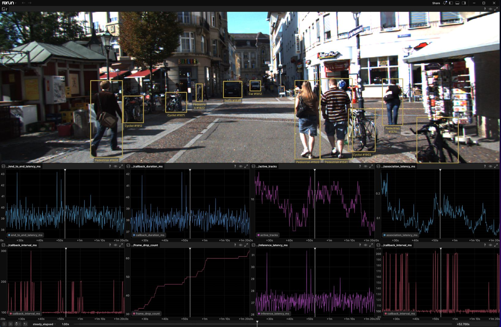
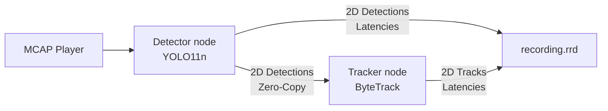
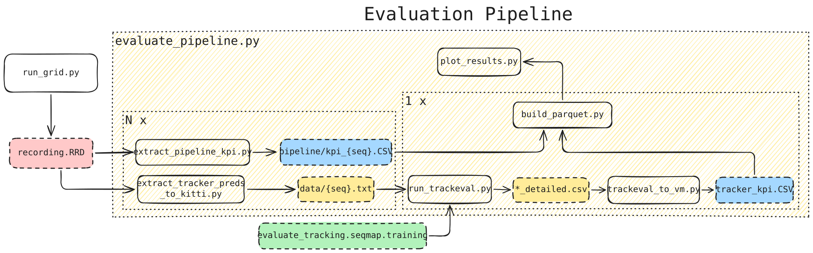

# ROS2 Multi-Object Tracking Pipeline — PC vs Jetson

**Latency, throughput and tracking-quality characterisation of a YOLO + ByteTrack ROS2 pipeline**

Modular ROS2 multi-object tracking (MOT) system and an experimental / evaluation harness for measuring how the same
pipeline behaves on a high-end PC versus a Jetson Orin NX 16GB.

<p align="center">
  
  <figcaption align="center"><em>Replaying recorded data in ReRun Viewer on KITTI Tracking sequence 0019.</em></figcaption>
</p>


## 🎯 Project Goal

Quantify the **latency distributions**, **frame drops**, **throughput** and **tracking quality** of a production-style
ROS2 MOT pipeline when moving from:

- **PC** — RTX 3090 24 GB
- **Jetson** — Orin NX 16 GB

under controlled MCAP replay of real tracking data.

The study examines:

- Platform effect (PC ↔ Jetson at matched precision)
- Precision effect (FP32 vs FP16, especially on Jetson)
- Executor threading (1 / 2 / 4 threads)
- Load / replay-rate effect (1.0× / 2.0× / 3.0×)


## 📌 Status & Scope

- ✅ Full experiment grid completed on both platforms (36 configs × 21 sequences)
- ✅ Metrics ETL pipeline → Parquet via [Apache Hamilton](https://hamilton.apache.org/)
- ✅ [TrackEval](https://github.com/JonathonLuiten/TrackEval) integration
- ❌ Fine-tuning MOT performance on KITTI Tracking dataset
- ❌ Live camera drivers, multi-camera, 3D lifting, online dashboards (out of scope)

This project prioritises **reproducible offline characterisation** of changes in latencies, frame drops, throughput and
tracking quality under realistic load and deployment to an embedded target.


## 📄 Report

A detailed write-up with experimental setup, figures and analysis lives in [`docs/report.md`](docs/report.md).


## ✨ Key Features

- **Modular ROS2 components via `ComposableNode`**
  - YOLO11n detector (ONNX Runtime)
  - ByteTrack tracker
  - Zero-copy intra-process communication
- **Timing & measurement**
  - Sensor timestamp propagation
  - Steady-clock latency and callback-duration logging
- **Offline observability**
  - From ReRun (`.rrd`) recordings to combined long-form Parquet metrics table
- **Configurable execution**
  - Single- or Multi-Threaded executor (`n_threads` launch argument)
- **Reproducible experiment grid**
  - All 21 KITTI Tracking training sequences
  - Cartesian product of precision × threads × rate


## 🏗️ Architecture

### ROS2 Pipeline

Both detector and tracker wrapped in their own separate `ComposableNodeContainer` launched as `ComposableNodeContainer`
as defined in [`launch/detector_test.launch.py`](launch/detector_test.launch.py).



### Evaluation Pipeline

Latencies and durations are measured using steady clocks and logged as ReRun recordings, which can be viewed later in
[ReRun Viewer](https://rerun.io/docs/getting-started/install-rerun/viewer). The recording RRD files can be transformed
into a long-form Parquet for offline analysis using the following evaluation ETL pipeline, orchestrating a number of
dedicated scripts (`scripts/eval`) as shown in the diagram.




## 📊 Experiment Grid

| Axis        | Values                   | Notes                                     |
|-------------|--------------------------|-------------------------------------------|
| Platform    | RTX 3090, Orin NX 16GB   | Same ROS2 graph                           |
| Precision   | FP32, FP16               | ONNX Runtime, `ExecutionProvider_CUDA_V2` |
| Threads     | 1, 2, 4                  | `component_container` / `*_mt`            |
| Replay rate | 1.0, 2.0, 3.0            | Multiplier on 10 Hz sequences             |
| Sequences   | All 21 KITTI train       | One run per sequence                      |

→ **18 configurations × 2 platforms = 36 configs**, 21 sequences each.


For Measured KPIs see [`docs/report.md`](docs/report.md).


## Assets

[`results/results.parquet`](https://github.com/jacobnzw/ros2-mot-pipeline/releases/tag/results_data) contains aggregated
KPIs (pipeline, MOT, device) for the entire experiment grid and was used to produce plots in the final report.


## 🚀 Quick Start

### Preliminary Setup

1. Create an account on the [KITTI Tracking evaluation page](https://www.cvlibs.net/datasets/kitti/eval_tracking.php).
2. From the repository root, create the download directory:
  ```sh
  mkdir -p data/kitti/left_color
  ```
3. Download both archives into `data/kitti/left_color/`:
    - [Left color tracking images (15 GB)](https://www.cvlibs.net/datasets/kitti/user_login.php) (file name
      `data_tracking_image_2.zip`)
    - [Tracking training labels (9 MB)](https://www.cvlibs.net/datasets/kitti/user_login.php) (file name
      `data_tracking_label_2.zip`)
4. Extract both archives from the repository root:
  ```sh
  # This creates `training/image_02/` and `training/label_02/` under `data/kitti/left_color/`.
  unzip data/kitti/left_color/data_tracking_image_2.zip -d data/kitti/left_color
  unzip data/kitti/left_color/data_tracking_label_2.zip -d data/kitti/left_color
  ```
5. Export the YOLO11n ONNX models. Ultralytics downloads `yolo11n.pt` if it is not already available; the `mv` commands
   give the exports the filenames selected by the launch file:
  ```sh
  mkdir -p models/yolo
  # Export FP32
  uv run yolo detect export model=yolo11n.pt format=onnx imgsz=352,1216 half=False
  mv yolo11n.onnx models/yolo/yolo11n_fp32.onnx
  # Export FP16
  uv run yolo detect export model=yolo11n.pt format=onnx imgsz=352,1216 half=True
  mv yolo11n.onnx models/yolo/yolo11n_fp16.onnx
  ```
6. Convert the extracted image sequences to MCAP bags, which the ROS 2 launch file expects:
  ```sh
  uv run scripts/kitti_to_mcap.py \
    data/kitti/left_color/training/image_02 \
    data/kitti/left_color/training/image_02_mcap
  ```

### Run and Evaluate

1. Build the ROS 2 workspace and source it (see [ROS 2 setup](docs/ros2_cpp_setup.md)).
2. Run one configuration:
  ```sh
  ros2 launch launch/detector_test.launch.py precision:=fp16 n_threads:=2 rate:=1.0 seq:=0019
  ```
3. Or run the experiment grid for the current platform:
  ```sh
  uv run scripts/eval/run_grid.py --config-basename my_grid
  ```
4. Evaluate the generated recordings, then build the Parquet table and plots:
  ```sh
  uv run scripts/eval/evaluate_pipeline.py --config 'my_grid_*'
  uv run python scripts/build_parquet.py --config 'my_grid_*' -o results/results.parquet
  uv run python scripts/plot_results.py results/results.parquet --output-dir results/figures
  ```

Further setup details and evaluation options are documented in `docs/`.


## 📁 Repository Layout

```text
├── README.md
├── docs/                       # Protocol, architecture, detailed report
├── launch/                     # detector_test.launch.py
├── scripts/
│   ├── eval/                   # Evaluation pipeline
│   ├── run_grid.py             # Run full grid
│   ├── build_parquet.py
│   └── plot_results.py
├── src/object_tracker/         # Detector + Tracker components
└── (data/)                     # (created) KITTI MCAPs / labels
├── (models/yolo/)              # (created) Ultralytics exported YOLO11n models
├── (runs/)                     # (created) Per-config outputs
```


*Built to understand the real cost of moving a ROS2 MOT pipeline from desktop to Jetson.*
