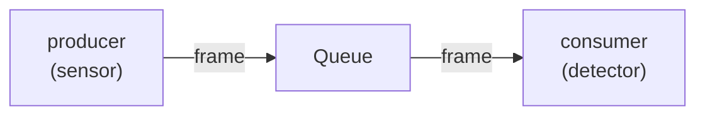

# Terminology
| Term | Meaning |
|---|---|
| Trajectory | Actual path the object travels in the scene. |
| Track | Belief about object's trajectory. |
| Tracklet | A tracklet is a short, continuous segment of a detected object's trajectory across a few consecutive frames. Oclusion splits object's full trajectory into several separate tracklets. |


# Data: KITTI Tracking

## Preprocessing
**Letterboxing** is a preprocessing step that resizes an image **while preserving its aspect ratio**, then pads the
remaining space (top/bottom or left/right) with a neutral fill value to reach the model's fixed input dimensions.

**Why it's needed:** Most models (e.g. YOLO) expect a fixed square input like 640×640. A naive `cv2.resize()` to that
size would **distort** the image — stretching or squishing objects — which degrades detection accuracy.

**How it works:**

1. Compute the scale factor: `scale = min(target_h / src_h, target_w / src_w)`
2. Resize the image by that factor (aspect ratio preserved)
3. Create a canvas of the target size filled with a padding value
4. Paste the resized image centered on the canvas

**The padding value** is typically a neutral gray — **114** (used by YOLOv8/Ultralytics) or **127** — chosen so that
after normalization (e.g. dividing by 255 and scaling to [-1, 1]) the padded pixels map to **zero activation**, meaning
they carry no semantic information the model would mistake for real content. A padded pixel at 0 contributes nothing to
the dot products in the first conv layer, so the model effectively ignores it.
```
x_normalized = (x / 255.0 - 0.5) * 2.0   
```

**Trade-off vs. simple resize:**

| | Letterbox | Simple Resize |
|---|---|---|
| Aspect ratio | Preserved | Distorted |
| Compute cost | Slightly higher (padding is "wasted" pixels) | All pixels are useful |
| Object geometry | Faithful | Skewed |

The small accuracy gain from letterboxing is usually negligible for most applications, but it's the standard in object
detection pipelines (YOLO, SSD, etc.) because it avoids the geometric distortion that can shift bounding box
predictions.


## Object types
| ID | Type |
|----|------|
| 0 | `Car` |
| 1 | `Van` |
| 2 | `Truck` |
| 3 | `Pedestrian` |
| 4 | `Person_sitting` |
| 5 | `Cyclist` |
| 6 | `Tram` |
| 7 | `Misc` |
| 8 | `DontCare` |

## 
| Ultralytics (`kitti.yaml`) | TrackEval / KITTI label file |
|---|---|
| `car` | `Car` |
| `person` | `Pedestrian` |
| `truck` | `Truck` |


# ByteTrack
Available via `ultralytics` directly
```python
from ultralytics import YOLO
from ultralytics.tracker import TRACKERS

# Uses default bytetrack thresholds
model = YOLO("yolo11n.pt")
# YOLO detections w/ conf >= 0.1 passed to ByteTrack to handle the thresholding
result = model.track(frame, conf=0.1, tracker="bytetrack.yaml")  


# For more control over ByteTrack thresholds
bytetrack_args = TRACKERS['bytetrack']
bytetrack_args['track_high_thresh'] = 0.6   # Raise for cleaner tracks
bytetrack_args['new_track_thresh'] = 0.5    # Lower to prevent unassigned tracks
bytetrack_args['track_buffer'] = 60         # Keep lost targets in memory longer (60 frames)

results = model.track(frame, tracker=bytetrack_args)

# Works directly on videos too
model.track(source="video.mp4", tracker=bytetrack_args)
```

Uses
```
A simple Kalman filter for tracking bounding boxes *in image space*.

The 8-dimensional state space

    x, y, a, h, vx, vy, va, vh

contains the bounding box center position (x, y), aspect ratio a, height h,
and their respective velocities.

Object motion follows a constant velocity model. The bounding box location
(x, y, a, h) is taken as direct observation of the state space (linear
observation model).
```

# Multi-Object Tracking Metrics

## CLEAR Metrics
The two core metrics are
| Metric | What it measures | Formula |
|--------|-----------------|---------|
| **MOTA** | Overall accuracy (detection + association) | $1 - \frac{FN + FP + IDSW}{GT}$ |
| **MOTP** | Localization precision only | $\frac{\sum IoU_{matched}}{TP}$ |

The CLEAR family in `trackeval` also reports:
| Sub-metric | Meaning |
|---|---|
| **MT** (Mostly Tracked) | # GT tracks tracked >80% of their lifetime |
| **PT** (Partially Tracked) | # GT tracks tracked 20–80% |
| **ML** (Mostly Lost) | # GT tracks tracked <20% |
| **Frag** (Fragmentations) | Times a tracked object becomes untracked then re-tracked |
| **IDSW** (ID Switches) | Identity changes between consecutive frames |
| **FP / FN** | Total false positives / false negatives |
| **CLR_Recall / CLR_Precision** | Fraction of GT detected / fraction of detections that are correct |
| **MTR / PTR / MLR** | MT, PT, ML expressed as ratios of total GT tracks |
| **FAR** (False Alarm Rate) | FP per frame |
| **MODA** | $1 - FN/GT$ (accuracy without ID switches) |
| **sMOTA / MOTAL** | Variants that exclude or re-weight certain error types |

## HOTA (Higher Order Tracking Accuracy)
is widely considered the superior and more balanced metric for evaluating Multi-Object Tracking (MOT) compared to **MOTA
(Multi-Object Tracking Accuracy)** because it equally weights detection and association accuracy. While **MOTA** is
heavily biased toward detection performance (explaining over 99% of its score variance based on detection alone) and
only measures "first-order" association (identity switches between consecutive frames), **HOTA** measures "higher-order"
association across the entire video sequence.

Key differences include:

*   **Balanced Scoring**: **HOTA** decomposes into **DetA** (Detection Accuracy) and **AssA** (Association Accuracy), combining them via the geometric mean: $$HOTA_{\alpha} = \sqrt{DetA_{\alpha} \cdot AssA_{\alpha}}.$$ This prevents a tracker from achieving a high score by merely detecting objects well while failing to maintain consistent IDs.
*   **Localization**: **HOTA** incorporates localization accuracy directly into its sub-metrics, whereas **MOTA**
    requires a separate metric (**MOTP**) to measure localization, making **HOTA** a more comprehensive single-score
    evaluation.
*   **Human Alignment**: Studies show **HOTA** aligns significantly better with human visual assessment (agreeing with
    human evaluators ~61.6% of the time vs. 38.4% for **MOTA**), making it the current standard for benchmarking
    state-of-the-art tracking algorithms.


# Latency Measurement
```python
start_event = torch.cuda.Event(enable_timing=True)
start_event.record()
```
For `start_event.record()` queues a marker on the current CUDA stream; it doesn’t start a CPU stopwatch. If
Python/Ultralytics takes time before queuing GPU work, the stream can sit idle after that marker. That idle gap can
therefore appear in the event interval. The events measure stream elapsed time, not just the sum of GPU kernels. If your
goal is kernel-only time, use a profiler; if your goal is how long model(input) takes to return with GPU work complete,
your synchronized `perf_counter` timing is the clearer metric.

`DataLoader` gives you a CPU tensor, and Ultralytics’ prediction path moves tensor inputs to the model’s device. Leaving
that transfer inside `model(input)` means your wall-clock measurement includes it. Move it to CUDA yourself only if you
deliberately want to exclude host-to-device transfer, and do so before starting the timer.

Hence wall-clock CPU time is preferred using `time.perf_counter()`, this is per-Frame inference-call latency
```python
# ...

torch.cuda.synchronize()  # Wait for the GPU to finish any current work
start_time = time.perf_counter()

_ = model(input, verbose=False)  # GPU works ...

torch.cuda.synchronize()  # Wait for the GPU to finish
latency_ms = (time.perf_counter() - start_time) * 1000

# ...
```

On CUDA, the synchronized `perf_counter()` timing waits for the call’s GPU work to finish, so it captures more than just
GPU kernel time: it includes CPU work inside `model(...)` and any input transfer Ultralytics performs there. It excludes
KITTI loading and resizing, which happen before the timed call.

**For a meaningful Jetson comparison**, run the same script and metric on both devices with
- the same model weights,
- KITTI frames,
- resolution,
- precision, and
- warmup count.

Keep the Jetson power mode and thermal conditions consistent, and label the result “inference-call latency,” not
“GPU-only latency.” Your per-frame median and p95 are useful; repeat the benchmark in multiple runs to see how much the
results vary.


## Throuput vs Latency
| Metric | Definition | Favored by |
|--------|-----------|------------|
| **Latency** | Time from request arrival → response (per-request) | Small batch (1), fewer concurrent requests |
| **Throughput** | Total requests/tokens processed per second | Large batch, many concurrent requests |

The core mechanism: A GPU's parallelism only helps if you feed it parallel work. Batch size is the primary lever:

- **Batch size 1** → lowest per-request latency, but GPU is underutilized → low throughput
- **Large batch size** → GPU is saturated, throughput maximized, but each request waits for the batch to complete →
  higher per-request latency

The relationship is **nonlinear**: going from batch 1→8 can give ~8× throughput with ~2× latency penalty, but 8→32 might
only give 2× more throughput with 5× more latency (diminishing returns as you hit the compute-bound regime).


# ONNX & TensorRT

> Always export to ONNX first. It's the de facto standard intermediate, and NVIDIA's own docs frame it as the primary
> path: "You typically start from a trained model exported to ONNX."

- **It's your debug checkpoint.** Validate the ONNX with onnxruntime on CPU before committing to a 30-min TensorRT
  build. Catches export bugs (shape mismatches, unsupported ops, custom op leaks) cheaply.
- **It's portable.** One .onnx file can feed TensorRT, ONNX Runtime on AMD/Intel/ARM, CoreML, TFLite, etc. The .engine
  is a dead end locked to one GPU + one TensorRT version.
- **It's versionable.** You can commit the ONNX to git, CI it, A/B test it, hand it to a teammate. An .engine is an
  opaque binary tied to your exact hardware.
- **TensorRT's primary input IS the ONNX parser.** Even when people say "go straight to TensorRT," they usually mean
  "skip ONNX Runtime" — not "skip the ONNX file." The OnnxParser is the standard ingestion path.

- **Build for latency**: set `max_batch_size`=1, tune `opt_shape` for single inference. Use `trtexec --batch=1` to
  benchmark.
- **Build for throughput**: set a larger `max_batch_size`, tune `opt_shape` for that batch. Throughput scales roughly
  linearly until you saturate compute.

You can build multiple engines (one per batch size) and dispatch at runtime based on current queue depth.


## Practical recommendation
```
PyTorch model
    │
    ▼
  .onnx  ← commit this, validate with onnxruntime, ship to team
    │
    ├──► ONNX Runtime (CPU / AMD / ARM / fallback)
    │
    └──► trtexec / TensorRT Builder → .engine (NVIDIA GPU, max perf)   
```

# ROS Workflows

## Observability

A practical production approach
- Keep the critical data path bounded and observable. Use sensor-appropriate QoS and bounded queues—often best effort
  and keep-last depth 1 for live images, where freshness matters more than delivering every old frame. Count or detect
  dropped frames rather than letting stale work accumulate.
- Publish lightweight health metrics continuously. Report rates, dropped-frame counts, inference and callback latency
  distributions, message age, and node health as low-rate diagnostics or metrics. Aggregate and publish periodically;
  avoid per-frame INFO logs in production, since logging itself can add I/O and scheduling load.
- Make live imagery opt-in and lower-cost. Whitelist only necessary topics, and only subscribe to the camera in Foxglove
  when needed. For routine monitoring, provide a separate low-resolution or lower-rate preview topic. If Foxglove
  overlays annotations on it, ensure the preview and annotations correspond to the same selected frame timestamps.
- Record selectively for later analysis. MCAP is a good choice for incident capture, offline visualization, and
  repeatable debugging. But recording is not free: the recorder is another subscriber and writes data to storage. Record
  the topics needed to answer likely questions, use rotating/split files or a bounded capture window, and test CPU, disk
  bandwidth, QoS compatibility, and message loss with recording enabled. “Record everything” is appropriate only when
  the resource and storage budget has been measured.
- Use tracing for execution timing questions. When you need to know where time goes across callbacks, executors,
  middleware, or scheduling, ROS 2 tracing is more informative than topic-rate commands or frame-by-frame logging.
  Measure the tracing overhead for your workload too.

A useful operational split is: lightweight metrics always on; a throttled preview available live; full-resolution
imagery and detailed traces captured for selected tests or incidents. Use MCAP to preserve evidence, but don’t assume
recording—or live visualization—has zero impact on the graph.


### Visualize 2D Bounding Box Annnotations in Foxglove

```shell
# Install foxglove bridge
sudo apt install ros-$ROS_DISTRO-foxglove-bridge

# Launch in separate terminal. Starts: mcap replay, detector, observer, foxglove_bridge
ros2 launch launch/detector_foxglove_test.launch.py

# Start Foxglove -> "Open Connection" -> "Open"
```

# ROS Middleware

- TODO: Understand how shared_ptr enables inter-process comms.
- TODO: Understand [QoS](https://docs.ros.org/en/jazzy/Concepts/Intermediate/About-Quality-of-Service-Settings.html)
- TODO: Understand queing pressure: what (causes) is it? alleviation? backpressure causes?
- TODO: Understand executors (single, multi-threaded, isolated) and callback groups; reentrancy
- TODO: Understand scheduling, preemption: how it affects the latencies, choice of queue depth etc.
- TODO: Given a real sensor instead of a bag player, how do the above concerns and mitigation strategies change?
- TODO: Understand who calls the callbacks? What could cause delays between callback calls?
- TODO: Understand middleware limits: characterizable using graph theory?
- TODO: Improve latency of YOLO11n: should be way ~1-3ms, which is way below the current 30ms on RTX3090

## Callback Groups & Executors
Callback groups control which callbacks are allowed to run in parallel when the executor is `MultiThreaded`. Callback
groups only matter when you are using a `MultiThreaded` executor. With the plain `component_container`
(`SingleThreaded`) everything is already serialized.


## Ingress Policies
Which to use depends on your goal:
- strict delivery (use block),
- bounded latency with some loss (drop-newest), or
- low latency / freshest output (latest).

### Block
Producer is blocked when the ingress buffer is full (backpressure). No frames are dropped, but backlog grows and
end-to-end latency can grow without bound. In the script they run it with a large ingress-capacity (256) so backlog
accumulates.

### Drop-newest
When the buffer is full, newly arriving frames are discarded. Drop-newest bounds latency by keeping the ingress queue at
a fixed maximum size and refusing (dropping) any newly arriving frames when that fixed-size buffer is full. Because the
queue length never grows, the maximum queuing delay for any frame is at most the time to process that many frames — so
latency is bounded at the cost of frame completeness (some frames never get processed).

### Latest
Keep only the most recent frame(s). Older buffered frames are discarded in favor of the newest. This minimizes latency
(you always process fresh data) at the cost of skipping intermediate frames. This is often preferred in real-time
systems where stale frames are useless.


### Overload Example: Slow Detector
> A 30 fps camera feeding a detector that manages only ~25 fps.



The choice of ingress policy doesn’t “speed up” the detector; it controls queuing, frame loss, and backpressure, which
change the observed end-to-end latency distribution and freshness of outputs. What the ingress policy changes is which
frames get processed, how many are queued (so how long frames wait before processing), and whether the producer is
blocked when the consumer is slower.

What the policy does affect:

- Queuing delay: how long a frame waits before the detector starts processing it (this is what you measure as end-to-end
  latency).
- Frame selection: which frames actually reach the detector (drop-newest, latest discard some frames).
- Backpressure: block causes the producer to stall; drop/newest/latest let the producer continue (possibly losing
  frames).
- Throughput vs freshness trade-off: block preserves all frames (max completeness), drop-newest bounds latency (loses
  recent arrivals), latest favors freshest frames (minimizes staleness).

Indirect system effects (rare, secondary):

- In real systems, queueing patterns can slightly change measured processing time because of scheduler behavior, cache
  locality, power/CPU frequency scaling, or the detector receiving more/less contention. Those are implementation-level
  effects and are not the policy magically making the algorithm faster.
- If the detector is adaptive (e.g., it reduces work when backlog is large, or batches frames when many are queued),
  then the ingress policy can indirectly change per-frame processing time by changing what the detector chooses to do.
  With a fixed, non-adaptive detector (like the fake backend), that doesn’t happen.


#### Does queue depth > 1 for latest policy even matter?

If your detector never batches and you always pop the single newest frame at dequeue time, then a one-slot "latest"
buffer gives you the same freshness/latency as a larger one. But there are practical reasons teams still choose a
`depth > 1`. Below are the key points and tradeoffs.

Why `depth = 1` is enough in the ideal model

- If the consumer always processes the freshest frame available and does not batch, keeping any older frames is
  pointless: they'll be stale by the time they’d be processed and you’ll never use them.
- With a perfect single-producer/single-consumer handoff (atomic swap or single-slot ring buffer with overwrite),
  depth=1 minimizes queuing delay and guarantees you always process the freshest sample.

Why people sometimes use `depth > 1` anyway

- Burst tolerance / scheduling jitter: real OS scheduling and brief producer/consumer jitter can create short bursts of
  arrivals while the consumer is preempted. A tiny extra capacity (2–4) lets you survive those bursts without dropping
  many frames or doing extra overwrites.
- Reduced contention / lock-free behavior: some lock-free queue implementations work more naturally or perform better
  with a small ring buffer rather than a single-slot atomic, especially with multiple producers or when you want to
  avoid spinning. A small depth can reduce CAS retries.
- Pipeline smoothing across stages: if downstream stages are partially parallel or have small variability, a bit of
  buffering can help keep the pipeline fed without producing long tails of staleness.
- Implementation semantics vary: “latest” can be implemented in different ways (single-slot overwrite, overwrite-oldest
  in an N-capacity ring, or consumer pops the newest among N). Those semantics affect whether an older slot is ever
  useful. Faults & temporary stalls: if a consumer crashes or stalls briefly and then recovers, a buffer >1 can help in
  graceful recovery or diagnostics (you may want to inspect recent frames). Instrumentation / metrics: retaining a short
  history of recent frames can help tracing and debugging.

When `depth > 1` is useful vs wasteful

- Useful: you need some resilience to producer bursts or scheduling noise, or your implementation/primitives work better
  with a small ring buffer.
- Wasteful: you strictly care about absolute freshness, you have a single reliable producer thread, and you can
  implement a cheap single-slot latest swap — then `depth > 1` mostly wastes memory and keeps stale frames around.

Recommendation

- If your only goal is freshest possible output and you have a simple single-producer/single-consumer design, use
  `depth = 1` (or a single atomic slot).
- If you want robustness to jitter and slightly smoother behavior in real OS environments, pick a small `depth` (2–4)
  and measure.
- If the detector might later support batching or adaptive behaviors, a larger buffer can enable batching at the cost of
  staleness — design intentionally for that.

# Links and References

[ROS2 Tracing](https://github.com/ros2/ros2_tracing)