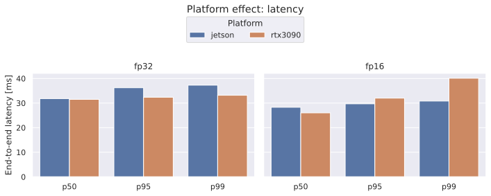
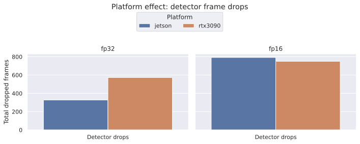
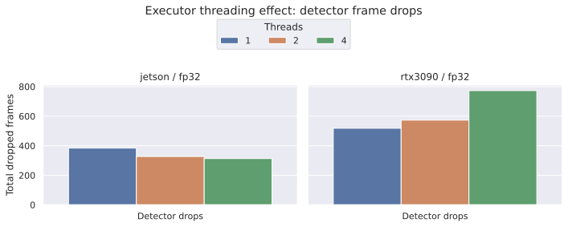
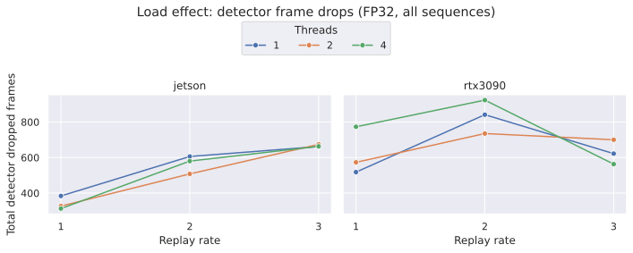
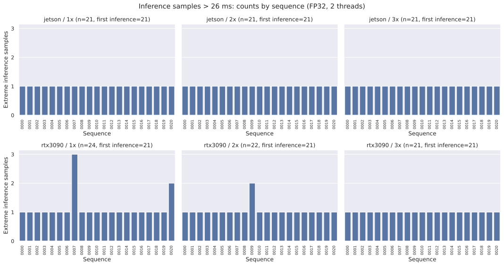

# Report

# Experiment Design & Protocol

Primary goal

> **Quantify the latency distribution and tracking-quality impact of moving a production-style ROS2 multi-object
> tracking pipeline from a high-end PC (RTX 3090) to a Jetson, under controlled MCAP replay of a real tracking
> sequence.**


## Platforms

### PC
The term "PC" refers to the following platform spec:

| Specification | Details |
|:--------------|:--------|
| Motherboard | ASUS ROG STRIX B650E-I GAMING WIFI |
| RAM | 64GB DDR5 |
| CPU | AMD Ryzen 9 7950X3D |
| GPU | MSI RTX 3090 Gaming X Trio, 24GB VRAM |
| Environment | WSL2 Ubuntu 24.04 |


### Jetson
The term "Jetson" refers to the following platform spec:

| Specification | Details |
|:--------------|:--------|
| Provider | [cloudjetson.com](https://cloudjetson.com) |
| Board | [Forecr DSBOARD-ORNX](https://www.forecr.io/products/carrier-board-dsboard-ornx) |
| SoM | [Orin NX 16GB](https://developer.download.nvidia.com/assets/embedded/secure/jetson/orin_nx/docs/Jetson_Orin_NX_DS-10712-001_v0.5.pdf?t=eyJscyI6ImdzZW8iLCJsc2QiOiJodHRwczovL3d3dy5nb29nbGUuY29tLyJ9&__token__=exp=1795098195~hmac=6608dc0c3a6e12b451eff756aa386069c42e3a6587d145723ce2caac2e037f4e) |
| Power mode | `MAXN_SUPER` |

| Host Environment | Version |
|:--------------|:--------|
| JetPack | 7.2.1 |
| Jetson Linux | 39.2.1 |
| CUDA | 13.2 |
| TensorRT | 10.16.2.10 |
| cuDNN | 9.20.0.46 |

The runtime environment was a Docker container built via
[`jetson-containers`](https://github.com/dusty-nv/jetson-containers/tree/master) with
```shell
CUDA_VERSION=13.2 jetson-containers build \
  --name=ros2-mot-jazzy \
  ros:jazzy-ros-base onnxruntime:1.25.1 \
  --skip-tests=all
```


## Run Configurations

I ran (2 x 3 x 3 = 18) design configurations on both platforms using the `scripts/run_grid.py` defined as Cartesian
product of the following axes:

```python
PRECISIONS = ("fp32", "fp16")
THREAD_COUNTS = (1, 2, 4)
RATES = (1.0, 2.0, 3.0)
```

## Measured KPIs

All logging was done via ReRun into an *.rrd files for easy viewing.

### Hardware

Hardware resource usage and sensor readings were measured to contextualize pipeline performance:

| Resource / sensor | Notes |
|:------------------|:------|
| CPU utilization | Utilization during replay |
| GPU utilization | Utilization during replay |
| Memory usage | System and GPU memory consumption, where available |
| Temperature | CPU/GPU or board temperatures reported by platform sensors |
| Power draw | System or board power reported by platform sensors |

Sensor availability and measurement scope may differ between the PC and Jetson. On PC, I relied on `psutils` and on
Jetson I used [`jetson-stats`](https://github.com/rbonghi/jetson_stats).

### ROS2 Pipeline

I measured and logged the following pipeline KPIs

| KPI | Notes |
|:----|:------|
| `pipeline/end_to_end_latency_ms` | Time from image timestamp to publishing the corresponding tracks; measures end-to-end responsiveness. |
| `detector/callback_interval_ms`  | Time between consecutive detector callback starts; indicates the effective processing cadence. |
| `detector/callback_duration_ms`  | Elapsed time for the detector callback, including preprocessing and inference. |
| `detector/preprocessing_latency_ms`  | Time spent preparing the image input for the model. |
| `detector/inference_latency_ms`  | Time spent running model inference. |
| `detector/frame_drop_count`  | Cumulative number of input frames dropped or skipped by the detector. |
| `tracker/callback_interval_ms` | Time between consecutive tracker callback starts; indicates the effective tracking cadence. |
| `tracker/callback_duration_ms` | Elapsed time for the tracker callback. |
| `tracker/association_latency_ms` | Time spent associating detections with existing tracks. |
| `tracker/active_tracks` | Number of tracks currently active during processing. |
| `tracker/frame_drop_count` | Cumulative number of frames dropped or skipped by the tracker. |


### Multi-Object Tracking

The resulting 2D tracks were also logged to compute the following MOT KPIs using
[`TrackEval`](https://github.com/JonathonLuiten/TrackEval) utilty:

|KPI | Notes |
|:---|:------|
| HOTA | Higher-Order Tracking Accuracy |
| IDF1 | ID switch F1 score |
| MOTP | Multi-Object Tracking Precision |


### Questions 
Given the platforms, the run configurations and the measured KPIs, the following questions about the ROS2 MOT pipeline
performance were analysed:

- **Platform Effect:** How do end-to-end latency, component latencies, frame drops, and MOT metrics change when moving
  from PC to Jetson at matched precision (FP32 and FP16 separately)?
- **Precision Effect:** What is the latency / frame drop / tracking-quality trade-off of FP16 vs FP32?
- **Executor Threading Effect:** Does increasing from 1 → 2 → 4 threads change latency tails, drop counts, or MOT
  metrics on either platform?
- **Load Effect:**
  - How do latency distributions and frame-drop counts scale with rate (1.0 / 2.0 / 3.0)?
  - At what point does the pipeline saturate on each platform?
- **Load x Platform Interaction:** Does the Jetson degrade more sharply than the PC as rate increases?
- **Deployment Effect:**
  - What's the MOT performance delta against PC @ FP32 baseline when I move the MOT pipeline to Jetson @ FP16 precision?
- **Resource Consumption:** What's the CPU / GPU utilisation, memory, and power / temperature under the different
  configurations?

Each of these questions are further elaborated on in the Results section.


# Results

Aspects:
- Latency:
   - Metrics: e2e_{p50,p95,p99} [ms]
- Frame drops:
   - Metrics: total frames dropped [count]
- MOT:
   - Metrics: HOTA, IDF1, MOTP, IDSW, Frag [%]


## Platform Effect
<!-- Fix: rate=1.0, threads=2, sequences="all" Switch: *precision* -->
<!-- bar chart per aspect: bar group by metric, bar per *platform* -->

- [ ] commentary





## Precision Effect
<!-- Fix: rate=1.0, threads=2, sequences="all" Switch: *platform* -->
<!-- bar chart per aspect: bar group by metric, bar per *precision*; -->

- [ ] commentary


## Executor Threading Effect
<!-- Fix: rate=1.0, sequences="all", precision=FP32 Switch: *platform* -->
<!-- bar chart per aspect: bar group by metric, bar per *n_threads*; -->

Directly answers “does the middleware concurrency model help or hurt on each platform?”

- [ ] commentary





## Load Effect
<!-- Fix: precision=FP32 # higher latency model Switch: *platform*, *sequences="all"* # could select a particular
sequence Parameter: threads -->
<!-- Line plot: X rate, Y total dropped frames; one line per thread count -->


As replay rate increases, how do frame-drop rates, latency tails, and tracking metrics change on Jetson versus PC? Does
the Jetson exhibit a steeper rise in drops or degradation in tracking quality?




## Load x Platform Interaction
<!-- Fix: n_threads=2, precision=fp32, sequences="all" -->
<!-- compare across rates inference latency histograms (tails) -->


Each sequence contains an extreme latency sample mostly just once. These could be explained as ONNX Runtime model warm
up effects during the start of the recording, which is indeed supported by the fact that most of these extreme inference
latencies occur within the first second, as shown in the following figures.




Inference latency distributions are shown below as box plots with the extreme values removed (first sample of each
sequence).


MOT KPIs shown below seem pretty much unaffected by the increasing replay rate. On Jetson, the HOTA and IDF1 slightly
drop with increased rate, while the MOTP is essentially unaffected. With KITTI Tracking sequence being recorded at 10 Hz
@ rate=1.0, the effect of increasing the rate to 3.0 gets us to 30 Hz, which barely satures the pipeline throuput, as
the p95 detector latency ~35 ms translates to slightly below 30 Hz.


## Deployment Effect

Fix: n_threads=2, rate=1.0, sequences="all"

deployments: {PC FP32, Jetson FP16}

- [ ] bar chart per aspect: bar group by metric, bar for deployment


## Resource Consumption

I didn't really measure the resouce usage of the process itself, just the overall system stats while it was running.

Makes sense: Power usage on Jetson,
- [ ] summarise CPU/GPU usage, memory, and power for different configs

### Misc

TODO: No observed effect on frame drop counts when increasing the QoS queue depth > 1 in the detections handoff to the
tracker.