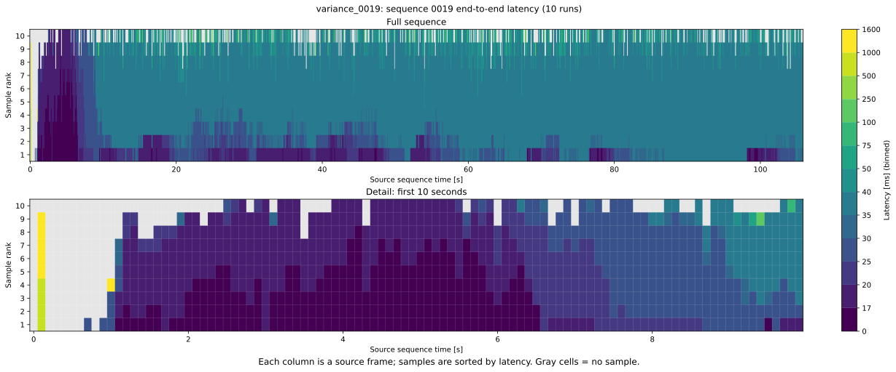
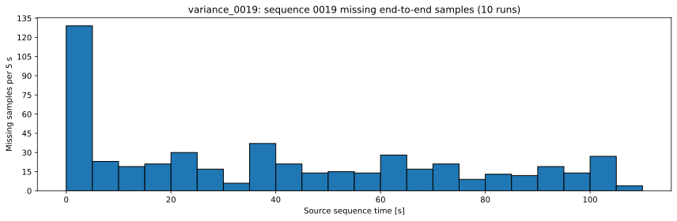
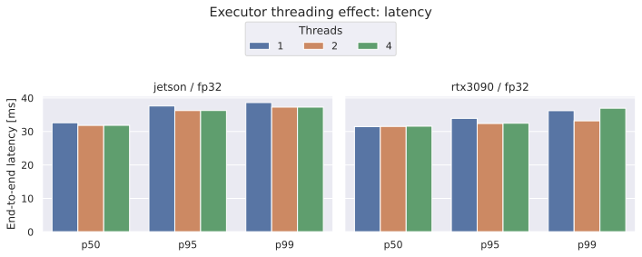
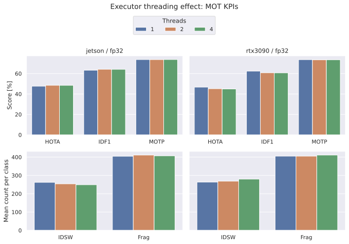
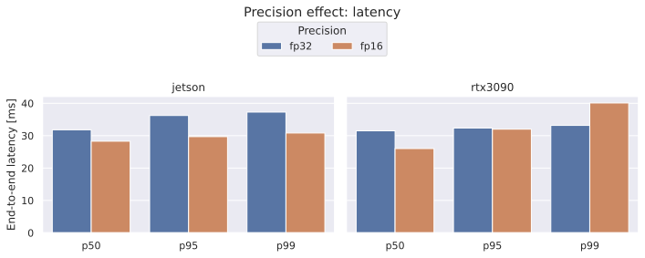
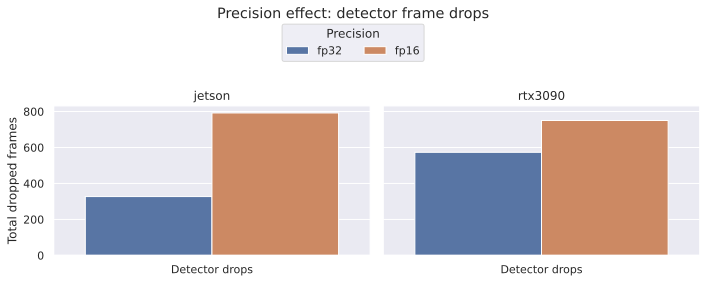
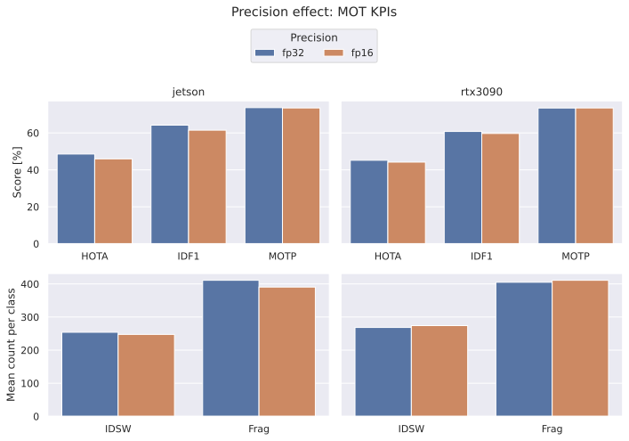
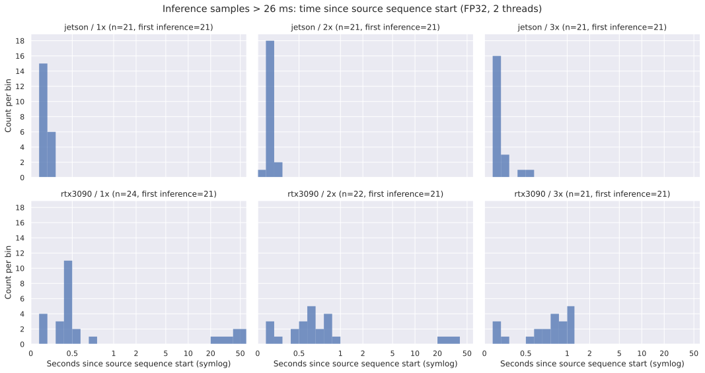
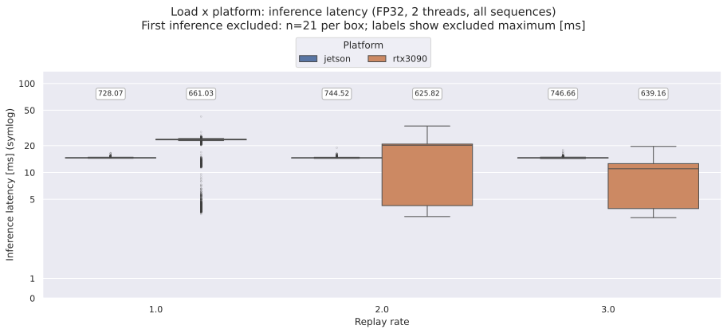
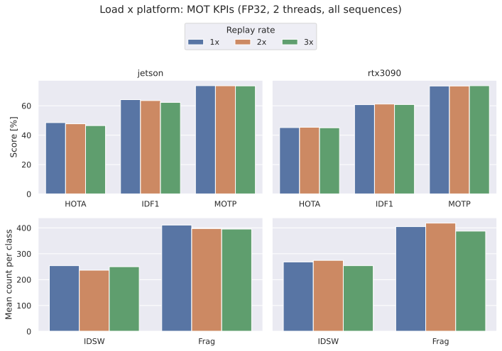

# Report

## Image Preprocessing
**Letterboxing** is a preprocessing step that resizes an image **while preserving its aspect ratio**, then pads the
remaining space (top/bottom or left/right) with a neutral fill value to reach the model's fixed input dimensions.

**Why it's needed:** Most models (e.g. YOLO) expect a fixed square input like 640×640. A naive `cv2.resize()` to that
size would **distort** the image — stretching or squishing objects — which degrades detection accuracy.

**How it works:**

1. Compute the scale factor: `scale = min(target_h / src_h, target_w / src_w)`
2. Resize the image by that factor (aspect ratio preserved)
3. Create a canvas of the target size filled with a padding value
4. Paste the resized image centered on the canvas

**The padding value** is typically a neutral gray — **114** (used by YOLOv8/Ultralytics) or **127** — chosen so that
after normalization (e.g. dividing by 255 and scaling to [-1, 1]) the padded pixels map to **zero activation**, meaning
they carry no semantic information the model would mistake for real content. A padded pixel at 0 contributes nothing to
the dot products in the first conv layer, so the model effectively ignores it.
```
x_normalized = (x / 255.0 - 0.5) * 2.0   
```

**Trade-off vs. simple resize:**

| | Letterbox | Simple Resize |
|---|---|---|
| Aspect ratio | Preserved | Distorted |
| Compute cost | Slightly higher (padding is "wasted" pixels) | All pixels are useful |
| Object geometry | Faithful | Skewed |

The small accuracy gain from letterboxing is usually negligible for most applications, but it's the standard in object
detection pipelines (YOLO, SSD, etc.) because it avoids the geometric distortion that can shift bounding box
predictions.


## Multi-Object Tracking Metrics

## CLEAR Metrics
The two core metrics are
| Metric | What it measures | Formula |
|--------|-----------------|---------|
| **MOTA** | Overall accuracy (detection + association) | $1 - \frac{FN + FP + IDSW}{GT}$ |
| **MOTP** | Localization precision only | $\frac{\sum IoU_{matched}}{TP}$ |

The CLEAR family in `trackeval` also reports:
| Sub-metric | Meaning |
|---|---|
| **MT** (Mostly Tracked) | # GT tracks tracked >80% of their lifetime |
| **PT** (Partially Tracked) | # GT tracks tracked 20–80% |
| **ML** (Mostly Lost) | # GT tracks tracked <20% |
| **Frag** (Fragmentations) | Times a tracked object becomes untracked then re-tracked |
| **IDSW** (ID Switches) | Identity changes between consecutive frames |
| **FP / FN** | Total false positives / false negatives |
| **CLR_Recall / CLR_Precision** | Fraction of GT detected / fraction of detections that are correct |
| **MTR / PTR / MLR** | MT, PT, ML expressed as ratios of total GT tracks |
| **FAR** (False Alarm Rate) | FP per frame |
| **MODA** | $1 - FN/GT$ (accuracy without ID switches) |
| **sMOTA / MOTAL** | Variants that exclude or re-weight certain error types |

## HOTA (Higher Order Tracking Accuracy)
is widely considered the superior and more balanced metric for evaluating Multi-Object Tracking (MOT) compared to **MOTA
(Multi-Object Tracking Accuracy)** because it equally weights detection and association accuracy. While **MOTA** is
heavily biased toward detection performance (explaining over 99% of its score variance based on detection alone) and
only measures "first-order" association (identity switches between consecutive frames), **HOTA** measures "higher-order"
association across the entire video sequence.

The localization threshold $\alpha$ is the minimum Intersection over Union (IoU) required for a predicted box and a
ground-truth box in the same frame to count as a match. For example, with $\alpha=0.5$, their IoU must be at least
$0.5$. A higher threshold requires tighter box alignment. HOTA computes its sub-metrics at multiple thresholds and
averages the results, so it reflects performance at both looser and stricter localization requirements.

At localization threshold $\alpha$, 
$$
\text{DetA}_{\alpha} = \text{TP}_{\alpha}/(\text{TP}_{\alpha}+\text{FN}_{\alpha}+\text{FP}_{\alpha})
$$.

$\text{AssA}_{\alpha}$ is the average, over true-positive matches, of their association Jaccard scores:
$$
\text{AssA}_{\alpha} = \frac{1}{|\text{TP}_{\alpha}|}\sum_{c \in \text{TP}_{\alpha}}
\frac{|\text{TPA}(c)|}{|\text{TPA}(c)|+|\text{FNA}(c)|+|\text{FPA}(c)|}
$$. 
Here, $c$ denotes one particular true-positive match at threshold $\alpha$: a ground-truth detection paired with a predicted detection in the same frame. For that match, consider the ground-truth trajectory and predicted trajectory it links across the sequence. $\text{TPA}(c)$ counts detections where this same trajectory pair is matched; $\text{FNA}(c)$ counts detections from the ground-truth trajectory not matched to that predicted trajectory; and $\text{FPA}(c)$ counts detections from the predicted trajectory not matched to that ground-truth trajectory. These counts give match $c$ its own association Jaccard score: consistent trajectory pairing raises the score, while switches or mismatches add errors and lower it. Averaging the score over all true-positive matches gives $\text{AssA}_{\alpha}$.

Key differences include:

*   **Balanced Scoring**: **HOTA** decomposes into **DetA** (Detection Accuracy) and **AssA** (Association Accuracy), 
    combining them via the geometric mean: $$\text{HOTA}_{\alpha} = \sqrt{\text{DetA}_{\alpha} \cdot \text{AssA}_{\alpha}}.$$ This prevents a tracker from achieving a high score by merely detecting objects well while failing to maintain consistent IDs.
                                                            
*   **Localization**: **HOTA** incorporates localization accuracy directly into its sub-metrics, whereas **MOTA**
    requires a separate metric (**MOTP**) to measure localization, making **HOTA** a more comprehensive single-score
    evaluation.
*   **Human Alignment**: Studies show **HOTA** aligns significantly better with human visual assessment (agreeing with
    human evaluators ~61.6% of the time vs. 38.4% for **MOTA**), making it the current standard for benchmarking
    state-of-the-art tracking algorithms.


## Latency Measurement
```python
start_event = torch.cuda.Event(enable_timing=True)
start_event.record()
```
For `start_event.record()` queues a marker on the current CUDA stream; it doesn’t start a CPU stopwatch. If
Python/Ultralytics takes time before queuing GPU work, the stream can sit idle after that marker. That idle gap can
therefore appear in the event interval. The events measure stream elapsed time, not just the sum of GPU kernels. If your
goal is kernel-only time, use a profiler; if your goal is how long model(input) takes to return with GPU work complete,
your synchronized `perf_counter` timing is the clearer metric.

`DataLoader` gives you a CPU tensor, and Ultralytics’ prediction path moves tensor inputs to the model’s device. Leaving
that transfer inside `model(input)` means your wall-clock measurement includes it. Move it to CUDA yourself only if you
deliberately want to exclude host-to-device transfer, and do so before starting the timer.

Hence wall-clock CPU time is preferred using `time.perf_counter()`, this is per-Frame inference-call latency
```python
# ...

torch.cuda.synchronize()  # Wait for the GPU to finish any current work
start_time = time.perf_counter()

_ = model(input, verbose=False)  # GPU works ...

torch.cuda.synchronize()  # Wait for the GPU to finish
latency_ms = (time.perf_counter() - start_time) * 1000

# ...
```

On CUDA, the synchronized `perf_counter()` timing waits for the call’s GPU work to finish, so it captures more than just
GPU kernel time: it includes CPU work inside `model(...)` and any input transfer Ultralytics performs there. It excludes
KITTI loading and resizing, which happen before the timed call.

**For a meaningful Jetson comparison**, run the same script and metric on both devices with
- the same model weights,
- KITTI frames,
- resolution,
- precision, and
- warmup count.

Keep the Jetson power mode and thermal conditions consistent, and label the result “inference-call latency,” not
“GPU-only latency.” Your per-frame median and p95 are useful; repeat the benchmark in multiple runs to see how much the
results vary.


## Throuput vs Latency
| Metric | Definition | Favored by |
|--------|-----------|------------|
| **Latency** | Time from request arrival → response (per-request) | Small batch (1), fewer concurrent requests |
| **Throughput** | Total requests/tokens processed per second | Large batch, many concurrent requests |

The core mechanism: A GPU's parallelism only helps if you feed it parallel work. Batch size is the primary lever:

- **Batch size 1** → lowest per-request latency, but GPU is underutilized → low throughput
- **Large batch size** → GPU is saturated, throughput maximized, but each request waits for the batch to complete →
  higher per-request latency

The relationship is **nonlinear**: going from batch 1→8 can give ~8× throughput with ~2× latency penalty, but 8→32 might
only give 2× more throughput with 5× more latency (diminishing returns as you hit the compute-bound regime).


## Warmp Up & Latency

The first inference calls after creating an ONNX Runtime (ORT) session are often slower than steady-state calls. Session
creation loads and checks the model, configures execution providers, and may perform graph optimizations; some work is
deferred until the first runs. Warm-up runs can trigger lazy kernel/provider initialization, memory and buffer
allocation, GPU context setup, and (depending on the execution provider and model) compilation or algorithm selection.
These one-time costs are then mostly avoided on later inferences, reducing and stabilizing their latency. Warm-up inputs
should use the same shapes and execution path expected in production; dynamic shapes may require warming each relevant
shape.

What is warmed is primarily the **runtime and execution path**, not the model's learned parameters. ORT does not change
the weights. Runtime/provider state, allocated buffers, hardware state, and possibly OS file pages become warm; the
exact pieces depend on the execution provider. There is no single universal “warm-up cache.”

Most in-memory ORT and provider state is lost when the process (or session/context) is destroyed, so a new process may
again incur first-run costs. Disk-backed compilation or engine caches, if explicitly enabled, and the OS page cache may
survive process exit; they disappear when cleared or evicted. A machine reboot clears volatile memory and GPU state, but
not persistent disk caches.


# Experiment Design & Protocol

Primary goal

> **Quantify the latency distribution and tracking-quality impact of moving a production-style ROS2 multi-object
> tracking pipeline from a high-end PC (RTX 3090) to a Jetson, under controlled MCAP replay of a real tracking
> sequence.**


## Platforms

### PC
The term "PC" refers to the following platform spec:

| Specification | Details |
|:--------------|:--------|
| Motherboard | ASUS ROG STRIX B650E-I GAMING WIFI |
| RAM | 64GB DDR5 |
| CPU | AMD Ryzen 9 7950X3D |
| GPU | MSI RTX 3090 Gaming X Trio, 24GB VRAM |
| Environment | WSL2 Ubuntu 24.04 |


### Jetson
The term "Jetson" refers to the following platform spec:

| Specification | Details |
|:--------------|:--------|
| Provider | [cloudjetson.com](https://cloudjetson.com) |
| Board | [Forecr DSBOARD-ORNX](https://www.forecr.io/products/carrier-board-dsboard-ornx) |
| SoM | [Orin NX 16GB](https://developer.download.nvidia.com/assets/embedded/secure/jetson/orin_nx/docs/Jetson_Orin_NX_DS-10712-001_v0.5.pdf?t=eyJscyI6ImdzZW8iLCJsc2QiOiJodHRwczovL3d3dy5nb29nbGUuY29tLyJ9&__token__=exp=1795098195~hmac=6608dc0c3a6e12b451eff756aa386069c42e3a6587d145723ce2caac2e037f4e) |
| Power mode | `MAXN_SUPER` |

| Host Environment | Version |
|:--------------|:--------|
| JetPack | 7.2.1 |
| Jetson Linux | 39.2.1 |
| CUDA | 13.2 |
| TensorRT | 10.16.2.10 |
| cuDNN | 9.20.0.46 |

The runtime environment was a Docker container built via
[`jetson-containers`](https://github.com/dusty-nv/jetson-containers/tree/master) with
```shell
CUDA_VERSION=13.2 jetson-containers build \
  --name=ros2-mot-jazzy \
  ros:jazzy-ros-base onnxruntime:1.25.1 \
  --skip-tests=all
```


## Run Configurations

I ran (2 x 3 x 3 = 18) design configurations on both platforms using the `scripts/run_grid.py` defined as Cartesian
product of the following axes:

```python
PRECISIONS = ("fp32", "fp16")
THREAD_COUNTS = (1, 2, 4)
RATES = (1.0, 2.0, 3.0)
```

## Measured KPIs

All logging was done via ReRun into an *.rrd files for easy viewing.

### Hardware

Hardware resource usage and sensor readings were measured to contextualize pipeline performance:

| Resource / sensor | Notes |
|:------------------|:------|
| CPU utilization | Utilization during replay |
| GPU utilization | Utilization during replay |
| Memory usage | System and GPU memory consumption, where available |
| Temperature | CPU/GPU or board temperatures reported by platform sensors |
| Power draw | System or board power reported by platform sensors |

Sensor availability and measurement scope may differ between the PC and Jetson. On PC, I relied on `psutils` and on
Jetson I used [`jetson-stats`](https://github.com/rbonghi/jetson_stats).

### ROS2 Pipeline

I measured and logged the following pipeline KPIs

| KPI | Notes |
|:----|:------|
| `pipeline/end_to_end_latency_ms` | Time since the executor ran the detector's `imageCallback` to the end of tracker's `detectionsCallback`; measures end-to-end responsiveness. The time the frame travelled from the MCAP player to the detector node is thus excluded. |
| `detector/callback_interval_ms`  | Time between consecutive detector callback starts; indicates the effective processing cadence. |
| `detector/callback_duration_ms`  | Elapsed time for the detector callback, including preprocessing and inference. |
| `detector/preprocessing_latency_ms`  | Time spent preparing the image input for the model. |
| `detector/inference_latency_ms`  | Time spent running model inference. |
| `detector/frame_drop_count`  | Cumulative number of input frames dropped or skipped by the detector. |
| `tracker/callback_interval_ms` | Time between consecutive tracker callback starts; indicates the effective tracking cadence. |
| `tracker/callback_duration_ms` | Elapsed time for the tracker callback. |
| `tracker/association_latency_ms` | Time spent associating detections with existing tracks. |
| `tracker/active_tracks` | Number of tracks currently active during processing. |
| `tracker/frame_drop_count` | Cumulative number of frames dropped or skipped by the tracker. |


### Multi-Object Tracking

The resulting 2D tracks were also logged to compute the following MOT KPIs using
[`TrackEval`](https://github.com/JonathonLuiten/TrackEval) utilty:

|KPI | Notes |
|:---|:------|
| HOTA | Higher-Order Tracking Accuracy |
| IDF1 | ID switch F1 score |
| MOTP | Multi-Object Tracking Precision |


### Questions 
Given the platforms, the run configurations and the measured KPIs, the following questions about the ROS2 MOT pipeline
performance were analysed:

- **Executor Threading Effect:** Does increasing from 1 → 2 → 4 threads change latency tails, drop counts, or MOT
  metrics on either platform?
- **Platform Effect:** How do end-to-end latency, component latencies, frame drops, and MOT metrics change when moving
  from PC to Jetson at matched precision (FP32 and FP16 separately)?
- **Precision Effect:** What is the latency / frame drop / tracking-quality trade-off of FP16 vs FP32?
- **Load Effect:**
  - How do latency distributions and frame-drop counts scale with rate (1.0 / 2.0 / 3.0)?
  - At what point does the pipeline saturate on each platform?
- **Load x Platform Interaction:** Does the Jetson degrade more sharply than the PC as rate increases?
- **Deployment Effect:**
  - What's the MOT performance delta against PC @ FP32 baseline when I move the MOT pipeline to Jetson @ FP16 precision?
- **Resource Consumption:** What's the CPU / GPU utilisation, memory, and power / temperature under the different
  configurations?

Each of these questions are further elaborated on in the Results section.


# Results

<!-- Aspects:
- Latency:
   - Metrics: e2e_{p50,p95,p99} [ms]
- Frame drops:
   - Metrics: total frames dropped [count]
- MOT:
   - Metrics: HOTA, IDF1, MOTP, IDSW, Frag [%] -->

## Execution-Time Variability

Execution times vary due to OS scheduling and hardware load, affecting latency and drops.

10 runs of the pipeline were performed on sequence 0019 (longest) to measure end-to-end latency variability.



Most frames are dropped at the start of the sequence.



- [ ] TODO: Compare with different q-depths to see if drops shift.


## Executor Threading Effect
<!-- Fix: rate=1.0, sequences="all", precision=FP32 Switch: *platform* -->
<!-- bar chart per aspect: bar group by metric, bar per *n_threads*; -->

Directly answers “does the middleware concurrency model help or hurt on each platform?”

Going from 1 to 2 threads generally reduces end-to-end latency slightly on both platforms, but going to 4 threads shows
no improvement on Jetson and even increases latency on PC.



In terms of frame drops, increasing threads doesn't have a clear benefit. On Jetson the frame drops decrease, while of
PC they increase with more threads.


For MOT KPIs, threading doesn't seem to have a strong impact on either platform. The scores stay mostly stable. There is
an interesting parallel in trends of ID switches (IDSW) and frame drops: on Jetson both decrease with more threads and
vice versa on PC, which would make sense if frame drops increase the likelihood of ID switches.



With these results in mind, it seems that using 2 threads is generally a good balance for both platforms and I thus kept
`n_threads=2` in the following experiments.


## Platform Effect
<!-- Fix: rate=1.0, threads=2, sequences="all" Switch: *precision* -->
<!-- bar chart per aspect: bar group by metric, bar per *platform* -->

The MOT pipeline with full precision (FP32) detector on Jetson exhibits longer end-to-end latency tails compared to PC.
This situation gets reversed with the half precision (FP16) model having shorter tails on Jetson and loger tails on PC.
Overall, Jetson benefits more from FP16.
<!-- Why might that be? -->
<!-- Jetson has better FP16 support, so it runs faster with half precision ??? -->


Total frames dropped in the FP32 detector node on Jetson is almost a half that on PC, while for the FP16 case the total
number of dropped frames is comparable.

<!-- Why might that be? -->
<!-- Could be due to Jetson handling FP32 better than PC? OS scheduling effects? -->


The impact of moving to Jetson from PC in terms of MOT performance is seen in the figure below. Overall, Jetson achieves
higher HOTA, IDF1 and MOTP scores, where higher is better, as well as lower IDSW and Frag at both model precisions
(except the very slightly higher Frag count for FP32, but the practical difference is negligible).


## Precision Effect
<!-- Fix: rate=1.0, threads=2, sequences="all" Switch: *platform* -->
<!-- bar chart per aspect: bar group by metric, bar per *precision*; -->

In terms of precision, Jetson handles the FP16 model better as exhibited by lower end-to-end latency compared to FP32.
On PC, we see rising percentiles for the FP16 model.



On both platforms we see more frame drops at FP16.



Halving the precision doesn't significantly affect MOT KPIs on either platform. The full-precision model achieves
slightly higher HOTA, IDF1 scores but, in terms of the other KPIs, the differences are minor.




## Load Effect
<!-- Fix: precision=FP32 # higher latency model Switch: *platform*, *sequences="all"* # could select a particular
sequence Parameter: threads -->
<!-- Line plot: X rate, Y total dropped frames; one line per thread count -->
To show the effect of increasing replay rate on the MOT pipeline performance, I chose to use the full-precision model as
it has higher latency which will make the effect more easily observable.

<!-- As replay rate increases, how do frame-drop rates, latency tails, and tracking metrics change on Jetson versus PC? Does the Jetson exhibit a steeper rise in drops or degradation in tracking quality? -->

Jetson exhibits clear rising trends in frame drops as the replay rate increases, while on PC number of dropped frames
peaks at double rate.


<!-- ## Load x Platform Interaction -->
<!-- Fix: n_threads=2, precision=fp32, sequences="all" -->
<!-- compare across rates inference latency histograms (tails) -->

Each sequence contains an extreme latency sample mostly just once. These could be explained as ONNX Runtime model warm
up effects during the start of the recording, which is indeed supported by the fact that most of these extreme inference
latencies occur within the first second, as shown in the following figures.




Inference latency distributions are shown below as box plots with the extreme values removed (first sample of each
sequence). The inference latency is more stable on Jetson, while on PC is starts to spread out with increasing replay
rate.
<!-- Why would inference latency be affected by increasing replay rate? -->



MOT KPIs shown below seem pretty much unaffected by the increasing replay rate. On Jetson, the HOTA and IDF1 slightly
drop with increased rate, while the MOTP is essentially unaffected. With KITTI Tracking sequence being recorded at 10 Hz
@ rate=1.0, the effect of increasing the rate to 3.0 gets us to 30 Hz, which barely satures the pipeline throuput, as
the p95 detector latency ~35 ms translates to slightly below 30 Hz.




## Deployment Effect

Fix: n_threads=2, rate=1.0, sequences="all"

deployments: {PC FP32, Jetson FP16}

- [ ] *bar chart per aspect: bar group by metric, bar for deployment*
- [ ] *Or make this a paragraph in precision effect section? It's more comfortable to compare visually here though.*


## Resource Consumption

I only measured the overall system resouce usage while the pipeline was running - not resources of the process itself.
Due to that, it still at least makes sense to report power usage on Jetson.

- [ ] *summarise CPU/GPU usage, memory, and power for different configs*
- [ ] *❓Overlay latency heatmap on 0019 sequence with power consumption*

### Misc

- [ ] *No observed effect on frame drop counts when increasing the QoS queue depth > 1 in the detections handoff to the
  tracker.*
- [ ] *Repeated runs on single sequence to characterize variability.*