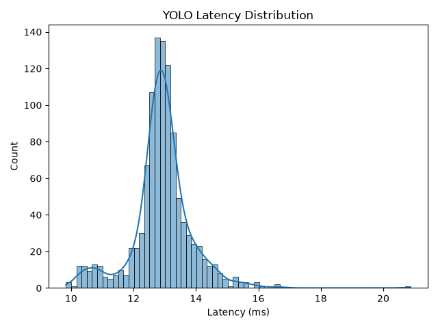
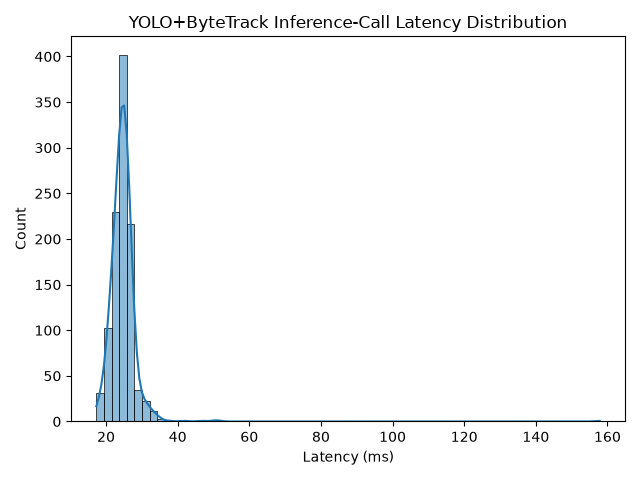

# Reproducibility

| Component | Choice | Reasons |
|---| ---|---|
| **Dataset** | KITTI Tracking: 0007, 0019 | Complementary # cars and peds |
| **Detector** | YOLO11-N | Better detection accuracy for smaller or overlapping objects |
| **Tracker** | ByteTrack | Very fast: it's only associator + KF|

- One annotated sequence for metrics: KITTI Tracking.
- One ROS-compatible source: a public ROS bag or a short self-recorded sequence (plan the recording this week if none
  exists).

## Dataset
KITTI Multi-Object Tracking sequences

```
Data Format Description
=======================

The data for training and testing can be found in the corresponding folders.
The sub-folders are structured as follows:

  - image_02/%04d/ contains the left color camera sequence images (png)
  - image_03/%04d/ contains the right color camera sequence images  (png)
  - label_02/ contains the left color camera label files (plain text files)
  - calib/ contains the calibration for all four cameras (plain text files)

The label files contain the following information. 
All values (numerical or strings) are separated via spaces, each row 
corresponds to one object. The 17 columns represent:

#Values    Name      Description
----------------------------------------------------------------------------
   1    frame        Frame within the sequence where the object appearers
   1    track id     Unique tracking id of this object within this sequence
   1    type         Describes the type of object: 'Car', 'Van', 'Truck',
                     'Pedestrian', 'Person_sitting', 'Cyclist', 'Tram',
                     'Misc' or 'DontCare'
   1    truncated    Integer (0,1,2) indicating the level of truncation.
                     Note that this is in contrast to the object detection
                     benchmark where truncation is a float in [0,1].
   1    occluded     Integer (0,1,2,3) indicating occlusion state:
                     0 = fully visible, 1 = partly occluded
                     2 = largely occluded, 3 = unknown
   1    alpha        Observation angle of object, ranging [-pi..pi]
   4    bbox         2D bounding box of object in the image (0-based index):
                     contains left, top, right, bottom pixel coordinates
   3    dimensions   3D object dimensions: height, width, length (in meters)
   3    location     3D object location x,y,z in camera coordinates (in meters)
   1    rotation_y   Rotation ry around Y-axis in camera coordinates [-pi..pi]
   1    score        Only for results: Float, indicating confidence in
                     detection, needed for p/r curves, higher is better.
```


I chose the following eval sequences
- 0007
    - mostly cars, vans, trucks, few peds
- 0019
    - mostly peds (crowded area), few cars, longest

by Running analysis script

`uv run scripts/kitti_label_stats.py data/kitti/left_color/training/label_02`

and inspecting the table showing object type counts across frames. Choosing sequences that are somewhat complementary in
the number of `Pedestrian` / `Person`/ `Cyclist` and `Car`/`Van`/`Truck`.

| Sequence | Length | Car | Cyclist | DontCare | Misc | Pedestrian | Person | Tram | Truck | Van | Objects Total |
|---|---:|---:|---:|---:|---:|---:|---:|---:|---:|---:|---:|
| 0000 | 154 | 243 | 154 | 378 | 0 | 22 | 0 | 0 | 0 | 292 | 1089 |
| 0001 | 447 | 2681 | 0 | 1241 | 20 | 112 | 0 | 0 | 77 | 140 | 4271 |
| 0002 | 233 | 1032 | 75 | 601 | 16 | 180 | 0 | 0 | 84 | 110 | 2098 |
| 0003 | 144 | 363 | 0 | 473 | 0 | 0 | 0 | 0 | 0 | 25 | 861 |
| 0004 | 314 | 818 | 60 | 899 | 0 | 65 | 0 | 51 | 27 | 92 | 2012 |
| 0005 | 297 | 1275 | 139 | 672 | 0 | 0 | 0 | 0 | 30 | 32 | 2148 |
| 0006 | 270 | 550 | 0 | 684 | 0 | 0 | 0 | 0 | 101 | 111 | 1446 |
| 0007 | 800 | 2258 | 0 | 988 | 121 | 67 | 0 | 0 | 58 | 230 | 3722 |
| 0008 | 390 | 1046 | 0 | 717 | 2 | 0 | 0 | 0 | 30 | 293 | 2088 |
| 0009 | 803 | 2859 | 0 | 1525 | 0 | 29 | 0 | 0 | 612 | 276 | 5301 |
| 0010 | 294 | 603 | 14 | 395 | 59 | 30 | 0 | 127 | 25 | 70 | 1323 |
| 0011 | 373 | 3405 | 0 | 571 | 0 | 201 | 0 | 0 | 0 | 182 | 4359 |
| 0012 | 78 | 144 | 41 | 105 | 0 | 64 | 0 | 0 | 0 | 0 | 354 |
| **0013** | 340 | 55 | 237 | 935 | 18 | 929 | 167 | 0 | 0 | 69 | 2410 |
| 0014 | 106 | 455 | 0 | 149 | 0 | 122 | 0 | 0 | 0 | 72 | 798 |
| 0015 | 376 | 899 | 537 | 1282 | 25 | 752 | 0 | 0 | 0 | 0 | 3495 |
| 0016 | 209 | 836 | 272 | 1010 | 0 | 2027 | 0 | 0 | 0 | 0 | 4145 |
| 0017 | 145 | 0 | 101 | 616 | 0 | 782 | 0 | 0 | 0 | 0 | 1499 |
| 0018 | 339 | 1354 | 0 | 381 | 0 | 0 | 0 | 0 | 0 | 59 | 1794 |
| **0019** | 1059 | 927 | 308 | 2366 | 91 | 6088 | 509 | 417 | 0 | 486 | 11192 |
| 0020 | 837 | 5497 | 0 | 2051 | 441 | 0 | 0 | 0 | 145 | 762 | 8896 |


Class Remapping Table
| KITTI class | YOLO11-n (COCO) class(es) | Recommendation for Phase 1 |
|---|---|---|
| Car | car | Keep (direct) |
| Van | car (or truck) | Map to Car |
| Truck | truck | Keep or map to Car |
| Pedestrian | person | Keep (direct) |
| Person_sitting | person | Map to Pedestrian |
| Cyclist | person + bicycle | Usually treat as Pedestrian (or ignore) |
| Tram | train / bus | Optional / ignore |
| Misc / DontCare | — | Discard |


## Latency

### Detector: YOLO11-n
Reproduce with
```shell
uv run scripts/latency_bench.py --kitti-seq path/to/downloaded/kitti/left_color/training/image_02/0019
```
Numbers should be similar. Exactly the same numbers impossible due to varying CPU/GPU load.

Using image resolution `(352, 1216)` as that's the closest multiple of `32` to the original `(375, 1242)`, required by
the YOLO11-N detector.

**Results**

| Metric | Value |
|---|---|
| Device | nVidia RTX3090 24GB VRAM  |
| Dataset | KITTI Tracking 0019  |
| Input resolution | (352, 1216)  |
| Frames | 1059  |
| Median Latency | 12.91 ms |
| P95 Latency | 14.43 ms |
| GPU Peak Memory | 82.03 MB |

<p align="center">
  
</p>

### Tracker: ByteTrack
Reproduce with
```shell
uv run scripts/latency_bench.py --kitti-seq path/to/downloaded/kitti/left_color/training/image_02/0019 --tracker
```

Measuring YOLO + ByteTrack inference-call latency.

**Results**

| Metric | Value |
|---|---|
| Device | nVidia RTX3090 24GB VRAM  |
| Dataset | KITTI Tracking 0019  |
| Input resolution | (352, 1216)  |
| Frames | 1059  |
| Median Latency | 28.28 ms |
| P95 Latency | 33.16 ms |
| GPU Peak Memory | 86.63 MB |

<p align="center">
  
</p>


## MOT Metrics

### TrackEval Dataset Config

```python
dataset_config = {
    "GT_FOLDER": "data/kitti/left_color/training",
    # Tracker predictions in a text file in KITTI format
    "TRACKERS_FOLDER": "data/kitti/trackers", 
    "TRACKERS_TO_EVAL": ["bytetrack"],
    "SPLIT_TO_EVAL": "training",
    "CLASSES_TO_EVAL": ["car", "pedestrian"],
}
```
The ByteTrack predictions for sequence 0019 should be placed in

```
data/kitti/trackers/bytetrack/data/0019.txt
```
Create `.seqmap` file under `{GT_FOLDER}/evaluate_tracking.seqmap.training` with file contents
```
0019 {GT_FOLDER}/image_02/0019 000000 001059
```
indicating sequence number, path, start frame, sequence length. Replace `{GT_FOLDER}` in the path specs with whatever
it's set to in the `dataset_config`.


Running this will produce the prediction for sequence `0019`

```shell
uv run scripts/mot_bench.py --kitti-seq data/kitti/left_color/training/image_02/0019
```

TrackEval evaluates every sequence with a `.txt` prediction file in the tracker's `data/` folder by default. To evaluate
only selected sequences, pass their IDs as a space- or comma-separated list. The KITTI `Kitti2DBox` implementation
supports only `car` and `pedestrian`.
```shell
uv run scripts/eval/run_trackeval.py \
  --gt-folder data/kitti/left_color/training \
  --tracker-folder data/kitti/trackers/bytetrack \
  --output-folder runs/<run-id>
```

For an explicit sequence selection:
```shell
uv run scripts/eval/run_trackeval.py \
  --sequence 0018 0019 \
  --gt-folder data/kitti/left_color/training \
  --tracker-folder data/kitti/trackers/bytetrack \
  --output-folder runs/<run-id>
```
The tracker folder must contain `data/<sequence>.txt`. The CLI selects the requested sequence from the existing
`evaluate_tracking.seqmap.<split>` in the GT folder without modifying that folder. Results are written under the output
folder, including per-class summary and detailed result files under `bytetrack/`. Using the run folder as the output
folder keeps the TrackEval results beside `recording.rrd`.

To run every KITTI sequence for the FP32/FP16, 1/4-thread, and 1.0/1.5/2.0/3.0-rate grid:

```shell
uv run scripts/eval/run_grid.py --config-basename <config-basename>
```

Each combination is run sequentially through `run_kitti_sequences.py` and gets a config label such as
`<config-basename>_FP32_t1_r1.0`.

### Hamilton evaluation pipeline

After `scripts/eval/run_kitti_sequences.py` has created the recordings and `metadata.yaml`, run the Hamilton DAG for the
whole config:

```shell
uv run scripts/eval/evaluate_pipeline.py --config <config>
```

The detector launch passes a five-second startup delay to bag playback, allowing time for pipeline initialization.
This delay does not guarantee that the pipeline is ready.

`--config` also accepts a quoted glob pattern matched against directory names in `runs/`, for example
`--config 'rtx3090*'`. Every matching directory that contains `metadata.yaml` is evaluated in turn. If a config fails,
the remaining ones still run, a summary is printed, and the exit code is non-zero.

Alternatively, pass an explicit metadata path with `--metadata runs/<config>/metadata.yaml`.

`run_kitti_sequences.py --config <config>` creates `runs/<config>/eval/label_02` as a symlink to the configured KITTI
labels and generates `runs/<config>/eval/evaluate_tracking.seqmap.training`. It counts image messages in each selected
MCAP for the seqmap's frame count and records both paths in `metadata.yaml`. The pipeline runs one parallel task per
recording to extract its pipeline KPI CSV. For repeated sequences, it extracts the ByteTrack prediction from the latest
recording by timestamp and evaluates each sequence once with TrackEval using the config-specific `trackeval_gt` folder.
It then exports tracker KPIs. Use `--max-workers` to change the number of concurrent tasks. Outputs are written to
`runs/<config>/eval/pipeline/kpi_<datetime>_<sequence>.csv`, `runs/<config>/eval/trackers/bytetrack/`, and
`runs/<config>/eval/tracker_kpi.csv`.

For offline analysis, combine the evaluated CSVs and sequence frame counts into one Parquet file with
`uv run python scripts/build_parquet.py --config '*_grid_*'`. The input requirements, schema, timestamp semantics, and
plotting considerations are documented in [data/README.md](../data/README.md).
The Parquet builder accepts both per-run CSVs and legacy `kpi_<sequence>.csv` files; it ignores a legacy file if a
per-run CSV for the same recording exists. Evaluation leaves legacy CSVs in place. The VictoriaMetrics ingestion
script imports every matching CSV, so remove any duplicate legacy files before ingestion.

For repeated runs of a single sequence, plot per-frame latency and missing end-to-end samples with:

```shell
uv run scripts/plot_sequence_variability.py results/variance_0019_results.parquet \
  --config variance_0019 --sequence 0019 --fps 10
```

The script uses the sequence frame count and reconstructs source timestamps using `kitti_to_mcap.py`'s formula.
`--fps` is the MCAP generation FPS, not the playback rate. The stacked latency plot shows one column per source frame:
stack height is the number of runs with a sample, and colors show binned latency. Samples are sorted by latency within
each column, so rows do not represent individual runs; gray cells indicate missing samples. The plot shows the full
sequence and a detail of its first ten seconds. Histogram bars sum missing samples across runs in five-second
source-time bins (`--bin-seconds` changes the bin width). Missing samples do not establish where or why a frame was
lost. Ensure the MCAP was generated with the specified FPS and inspect startup and shutdown effects separately.

The Parquet file must include the original `ros2_timestamp_ns` timeline. CSVs exported before that field was added
need to be re-exported from their Rerun recordings and the Parquet file rebuilt; legacy CSVs remain readable but their
timeline fields are null. Re-running evaluation overwrites its existing per-run CSVs and tracker results.

While sequences run, `run_kitti_sequences.py` records device metrics to
`runs/<config>/eval/device_metrics.csv`. The VictoriaMetrics/Grafana ingestion script imports this CSV when present.
The runner passes `jetson` or a compact GPU 0 model label to both metadata and the monitor. For PC runs, it removes
the `NVIDIA` and `GeForce` prefixes and whitespace from the name reported by `nvidia-smi` and lowercases it (for
example, `NVIDIA GeForce RTX 3090` becomes `rtx3090`). Any non-`jetson` label uses PC monitoring, which samples GPU 0.
To run the monitor directly for a config, pass its exact metadata hardware label, for example
`uv run scripts/monitor.py --hardware rtx3090 --config <config>`. The monitor also accepts `--out-name` and `--freq`.
Older runs used `rtx3090` in metadata and `pc` in device metrics; the Parquet builder normalizes those device labels.

To start the VictoriaMetrics/Grafana Compose stack and ingest every pipeline KPI CSV, the tracker KPI CSV, and the
device metrics CSV (when present) for a config:

```shell
scripts/eval/vm_grafana_ingest.sh <config>
```

The argument may also be a quoted glob pattern matched against directory names in `runs/`, which ingests every matching
config (for example, `'rtx3090*'`). Quote the pattern so the shell does not expand it. Matching configs without the
required KPI CSVs are skipped with a warning; the script fails if none can be ingested. The script waits for both
services to be ready before importing the CSVs. The stack and persistent Docker volumes remain running after ingestion.

Pass `--ingest-only` to skip starting the Compose stack and only POST the CSVs to an already running VictoriaMetrics at
`127.0.0.1:8428`:

```shell
scripts/eval/vm_grafana_ingest.sh --ingest-only 'rtx3090*'
```

The KPI CSV contains one row per TrackEval summary metric, class, and sequence, including TrackEval's `COMBINED` row,
with the supplied hardware, precision, and config metadata. Scores remain ratios in `[0, 1]`; count metrics remain
counts. `scripts/eval/trackeval_to_vm.py runs/<run-id> --hw jetson-orin --precision fp16 --config baseline` can export
the KPI CSV with these metric label values without importing it.

Use `--split` for a non-training seqmap and `--classes` to select either or both supported classes.

### Baseline
Evaluated on sequence `0019` only. For now!

Achieved results are as follows:
```
Evaluating bytetrack

1 eval_sequence(0019, bytetrack)                                         0.7266 sec

All sequences for bytetrack finished in 0.73 seconds

HOTA: bytetrack-car                HOTA      DetA      AssA      DetRe     DetPr     AssRe     AssPr     LocA      OWTA      HOTA(0)   LocA(0)   HOTALocA(0)
0019                               49.423    52.537    46.825    62.342    64.794    49.148    77.658    78.67     53.955    66.096    73.79     48.773    
COMBINED                           49.423    52.537    46.825    62.342    64.794    49.148    77.658    78.67     53.955    66.096    73.79     48.773    

CLEAR: bytetrack-car               MOTA      MOTP      MODA      CLR_Re    CLR_Pr    MTR       PTR       MLR       sMOTA     CLR_TP    CLR_FN    CLR_FP    IDSW      MT        PT        ML        Frag      
0019                               60.562    75.468    62.271    79.243    82.36     50        50        0         41.121    649       170       139       14        3         3         0         10        
COMBINED                           60.562    75.468    62.271    79.243    82.36     50        50        0         41.121    649       170       139       14        3         3         0         10        

Identity: bytetrack-car            IDF1      IDR       IDP       IDTP      IDFN      IDFP      
0019                               63.348    62.149    64.594    509       310       279       
COMBINED                           63.348    62.149    64.594    509       310       279       

Count: bytetrack-car               Dets      GT_Dets   IDs       GT_IDs    
0019                               788       819       27        6         
COMBINED                           788       819       27        6         

HOTA: bytetrack-pedestrian         HOTA      DetA      AssA      DetRe     DetPr     AssRe     AssPr     LocA      OWTA      HOTA(0)   LocA(0)   HOTALocA(0)
0019                               39.351    42.823    36.533    50.037    58.04     41.609    61.603    72.887    42.693    61.861    63.982    39.58     
COMBINED                           39.351    42.823    36.533    50.037    58.04     41.609    61.603    72.887    42.693    61.861    63.982    39.58     

CLEAR: bytetrack-pedestrian        MOTA      MOTP      MODA      CLR_Re    CLR_Pr    MTR       PTR       MLR       sMOTA     CLR_TP    CLR_FN    CLR_FP    IDSW      MT        PT        ML        Frag      
0019                               46.561    67.89     48.247    67.228    77.982    25.806    69.355    4.8387    24.974    3949      1925      1115      99        16        43        3         244       
COMBINED                           46.561    67.89     48.247    67.228    77.982    25.806    69.355    4.8387    24.974    3949      1925      1115      99        16        43        3         244       

Identity: bytetrack-pedestrian     IDF1      IDR       IDP       IDTP      IDFN      IDFP      
0019                               56.519    52.622    61.039    3091      2783      1973      
COMBINED                           56.519    52.622    61.039    3091      2783      1973      

Count: bytetrack-pedestrian        Dets      GT_Dets   IDs       GT_IDs    
0019                               5064      5874      176       62        
COMBINED                           5064      5874      176       62
```

with the following TrackEval config summary:
```
Kitti2DBox Config:
GT_FOLDER            : data/kitti/left_color/training
TRACKERS_FOLDER      : data/kitti/trackers           
TRACKERS_TO_EVAL     : ['bytetrack']                 
SPLIT_TO_EVAL        : training                      
CLASSES_TO_EVAL      : ['car', 'pedestrian']         
OUTPUT_FOLDER        :                               
INPUT_AS_ZIP         : False                         
PRINT_CONFIG         : True                          
TRACKER_SUB_FOLDER   : data                          
OUTPUT_SUB_FOLDER    :                               
TRACKER_DISPLAY_NAMES : None                          
Reading from seqmap_file='data/kitti/left_color/training/evaluate_tracking.seqmap.training'...

CLEAR Config:
THRESHOLD            : 0.5                           
PRINT_CONFIG         : True                          

Identity Config:
THRESHOLD            : 0.5                           
PRINT_CONFIG         : True                          

Eval Config:
USE_PARALLEL         : False                         
PRINT_RESULTS        : True                          
OUTPUT_SUMMARY       : True                          
NUM_PARALLEL_CORES   : 8                             
BREAK_ON_ERROR       : True                          
RETURN_ON_ERROR      : False                         
LOG_ON_ERROR         : /home/jacob/ros2-mot-pipeline/.venv/lib/python3.14/site-packages/error_log.txt
PRINT_ONLY_COMBINED  : False                         
PRINT_CONFIG         : True                          
TIME_PROGRESS        : True                          
DISPLAY_LESS_PROGRESS : True                          
OUTPUT_EMPTY_CLASSES : True                          
OUTPUT_DETAILED      : True                          
PLOT_CURVES          : True                          

Evaluating 1 tracker(s) on 1 sequence(s) for 2 class(es) on Kitti2DBox dataset using the following metrics: HOTA, CLEAR, Identity, Count
```


## ONNX Export

Via Ultralytics CLI with [export settings](https://docs.ultralytics.com/usage/cfg#export-settings) See
[Export Guide](https://docs.ultralytics.com/modes/export).


```shell
uv run yolo detect export model=yolo11n.pt format=onnx imgsz=352,1216
```

```shell
ONNX: starting export with onnx 1.23.2 opset 18...
ONNX: slimming with onnxslim 0.1.97...
ONNX: export success ✅ 7.4s, saved as 'yolo11n.onnx' (10.3 MB)

Export complete (7.9s)
Results saved to /home/jacob/ros2-mot-pipeline/yolo11n.onnx
Predict:         yolo predict task=detect model=yolo11n.onnx imgsz=352,1216 
Validate:        yolo val task=detect model=yolo11n.onnx imgsz=352,1216   WARNING ⚠️ non-PyTorch val requires square images, 'imgsz=[352, 1216]' will not work. Use export 'imgsz=1216' if val is required.
Visualize:       https://netron.app
```

Export to FP16
```shell
uv run yolo export model=models/yolo/yolo11n.pt format=onnx imgsz=352,1216 half=True
```

Export TensorRT engine to INT8, needs calibration dataset supplied via dataset_yaml
```shell
uv run yolo export model=models/yolo/yolo11n.pt format=engine imgsz=352,1216 int8=True data={dataset_yaml}
```

## Comparison figures

Generate SVG and PNG figures from the evaluated Parquet file:

```shell
uv run python scripts/plot_results.py results/results.parquet --output-dir results/figures
uv run python scripts/plot_results.py results/results.parquet --effect platform --output-dir results/figures
uv run python scripts/plot_results.py results/results.parquet --effect executor --output-dir results/figures
uv run python scripts/plot_results.py results/results.parquet --effect load --output-dir results/figures
uv run python scripts/plot_results.py results/results.parquet --effect load-platform --output-dir results/figures
uv run python scripts/plot_results.py results/results.parquet --effect load-platform-mot --output-dir results/figures
uv run python scripts/plot_results.py results/results.parquet --effect load-platform-box --output-dir results/figures
uv run python scripts/plot_results.py results/results.parquet --effect load-platform-extremes --output-dir results/figures
uv run python scripts/plot_results.py results/results.parquet --effect load-platform-sequence-time --output-dir results/figures
```

The first command produces precision-effect figures, comparing FP32 and FP16 for each platform. The second produces
platform-effect figures, comparing platforms for each precision. The third compares one, two, and four executor
threads separately for each platform at FP32 precision. The fourth plots FP32 detector drops against replay rate
for each platform and thread count. Its default uses all sequences; add `--sequence 0019` to plot one sequence
instead, without overwriting the all-sequence plot. Use `--effect all` to generate all sets; `--sequence` then applies
only to the load plot. The load-platform figure shows pooled detector inference latency for each platform and replay
rate at FP32 and two threads. Its panels use common logarithmically spaced bins above 1 ms, a shared symmetric-log
latency axis (linear below 1 ms), and a shared log-scaled percentage axis; percentages are normalized per panel.
The load-platform MOT figure compares replay rates at FP32 and two threads, with one column per platform. Its top
row shows HOTA, IDF1 and MOTP as percentages; its bottom row shows IDSW and Frag as mean counts per class.
All values use ByteTrack `COMBINED` results macro-averaged across car and pedestrian, with matched sequence inventories.
The load-platform box plot groups pooled inference samples by rate and platform after excluding the first inference
sample from each recording. Labels in the headroom above the boxes show the maximum excluded latency for each group;
the labels are not positioned according to those excluded values. The title reports the number excluded per box;
if counts differ, each label includes its own count.
The first sample means the earliest exported inference timestamp; it must be unique at millisecond resolution, or
the plot fails rather than excluding an arbitrary sample. The exporter may use a source-frame timeline instead of
the inference-completion timeline, so check the recording's timeline before interpreting this as logging order.
The symmetric-log latency axis starts at zero and is linear below 5 ms. Boxes and whiskers are
computed from the remaining millisecond values: whiskers extend to the most extreme samples within 1.5 times the
interquartile range, and points beyond them are shown as outliers. Excluding the first inference does not establish
that all warmup effects are gone.
The separate load-platform extremes figures use the full samples and plot timestamps and per-sequence counts for
samples strictly above the highest p99.5 across the six platform/rate groups, rounded up to whole milliseconds
(at least 1 ms). Timestamps are seconds from the first observed pipeline scalar in each recording, not from the
exact replay start. The exporter prefers the `steady_elapsed` timeline, where inference is logged after it completes,
but can fall back to `ros2_timestamp` (the image timestamp); the Parquet file does not record which timeline was used.
The selected source recordings should therefore be checked before interpreting elapsed times as logging times. Panel
annotations count samples whose timestamp matches the first inference timestamp in that recording, including ties at
millisecond resolution. Histogram bins are 0.1 seconds up to 1 second and progressively wider afterward; the
elapsed-time axis is symmetric-log.
The separate sequence-time figure uses the input image's `ros2_timestamp` from each original Rerun recording,
relative to the first image header timestamp in that sequence's source MCAP. It shows position in the source
sequence, not wall-clock elapsed replay time, which varies with replay rate. It checks the recording's inference
samples against the Parquet timestamps and values, and requires the `steady_elapsed` and `ros2_timestamp` timelines.
By default, recordings are read from `runs/<config>/<run>/recording.rrd` and source bags from
`data/kitti/left_color/training/image_02_mcap/<sequence>/<sequence>.mcap`; override the roots with `--runs-dir` and
`--sequences-dir`. This additional figure is not included in `--effect all`, which works with the Parquet file alone.
The first three sets contain three figures at rate 1.0; the precision and platform comparisons use two executor
threads. End-to-end
latency percentiles are calculated over samples pooled across all sequences. Detector frame drops are summed
across sequences after taking the maximum cumulative count per recording. MOT uses ByteTrack's `COMBINED`
rows, macro-averaged over car and pedestrian; HOTA, IDF1 and MOTP are percentages, while IDSW and Frag are
mean counts per class. Scores and counts use separate axes.